# 🛡️ AeroShield AI 2.0
### Autonomous GenAI-Powered Community & Family Clean-Air Assistant for Severe Winter Smog & Urban Pollution

[](https://nodejs.org/)
[](ACCESSIBILITY.md)
[](SECURITY.md)
[](test_runner.js)
[](LICENSE)

---

## 📌 Executive Summary & Root Challenge

During winter, major urban regions (the Indo-Gangetic Plain including Delhi-NCR and Lahore, the North China Plain including Beijing, the Po Valley in Northern Italy, the Wasatch Front in Salt Lake City, and London) suffer from catastrophic **severe winter smog episodes** (AQI 300–600+).

This crisis is driven by a dangerous meteorological phenomenon: **Thermal Inversion and Planetary Boundary Layer (PBL) Collapse**. At night, ground surfaces rapidly radiate heat under clear winter skies. A warm inversion layer acts as an impermeable atmospheric lid, trapping vehicular exhaust, biomass burning smoke, and industrial particulate matter into a shallow 80–120m cold pool. 

Most citizens either helplessly inhale toxic aerosols or buy expensive $400 commercial HEPA purifiers with proprietary filters that low-income communities cannot afford. Furthermore, people often open windows during peak smog hours or exercise when inversion trapping is at its worst.

**AeroShield AI** is an autonomous, generative AI-powered environmental resilience platform engineered for families and communities. It synthesizes atmospheric physics, mass-balance aerosol differential equations, multi-agent GenAI guidance, and smart home IoT automation to:
1. **Forecast Planetary Boundary Layer Inversions** and identify the safe **"Golden Ventilation Window"** (13:00–15:30) when convective mixing disperses trapped ground pollution.
2. **Simulate Indoor Air Quality (IAQ) via a Digital Twin** powered by the scientific aerosol mass balance equation:
   $$\frac{dC_{in}(t)}{dt} = P \cdot a \cdot C_{out}(t) + \frac{S(t)}{V} - \left(a + k + \frac{CADR}{V}\right) C_{in}(t)$$
3. **Prescribe Peer-Reviewed DIY Filtration Hacks** (such as the **Corsi-Rosenthal Box** with a 15-inch fan shroud delivering 520 CFM CADR for $55 vs $450 commercial purifiers, negative-pressure kitchen isolation, capillary wet-mopping, and NASA CAM botanical clusters).
4. **Generate Tailored Low-Emission Routines & Sustainable Transitions** customized for high-vulnerability family members (infants, asthmatics, elderly, pregnant mothers) and clean lifestyle shifts (inverter heat pumps, induction cooktops, e-commute syndicates).
5. **Orchestrate Neighborhood Defense Grids** (carpooling pools, idle-free school drop-off zones, purifier libraries, and zero-burning community leaf compost depots).
6. **Quantify Direct Personal & Community Impact** with mathematical transparency (micrograms of PM2.5 spared from lungs, cigarette smoke equivalents avoided based on Berkeley Earth formulations, and kilograms of $CO_2$ prevented).
7. **Automate Smart Home IoT Smog Defense & Bookings** (Home Assistant YAML, IFTTT, and Google Home routines that auto-engage purifiers on smog spikes, broadcast window-sealing reminders, and book community equipment).

---

## 🏗️ Architecture & System Workflow

The following diagram illustrates the complete end-to-end architecture of AeroShield AI 2.0, detailing data flow from real-time meteorological monitoring to AI multi-agent synthesis, physics simulation, task automation, and external IoT execution:

```mermaid
flowchart TD
    subgraph ClientLayer["🖥️ Frontend Client Layer (Cyber UI & Interactive Physics)"]
        UI["AeroShield Web App (HTML5 / Vanilla JS / CSS)"]
        CANVAS1["Inversion Radar Chart (HTML5 Canvas)"]
        CANVAS2["Indoor Digital Twin Chart (24h Mass Balance)"]
        CANVAS3["AeroChamber™ 2D Particle Dynamics Simulator"]
        CALC["Interactive CADR & Room Sizing Calculator"]
        VOICE["Web Speech API (Voice Smog Audio Briefing)"]
        TOAST["Cyber Notification Toast & State Manager"]
    end

    subgraph SecurityGateway["🔒 Security & API Gateway Layer (Express.js)"]
        GW["Reverse Proxy / Express App (Port 3000)"]
        HELMET["Helmet Middleware (Strict CSP, XSS Protection)"]
        CORS["CORS Configuration"]
        LIMIT["Tiered Rate Limiter (150 API / 45 AI req)"]
        SANIT["Recursive Input Sanitizer (XSS Neutralizer)"]
        CACHE["In-Memory LRU/TTL Cache Service"]
    end

    subgraph PhysicsEngines["🔬 Scientific Physics & Algorithmic Engines"]
        INVERSION["inversionService<br/>• Stull Boundary Layer Model<br/>• Golden Window Detector (13:00-15:30)<br/>• Inversion Score (1-10)"]
        IAQ["iaqPhysicsService<br/>• Aerosol Mass Balance Differential Solver<br/>• Loss Rate λ & Steady-State Cin_ss<br/>• CADR Pull-Down Time Solver"]
        ROUTINE["routineService<br/>• Pediatric & Asthma Vulnerability Profiler<br/>• 7-Phase Low-Emission Schedule<br/>• Sustainable Tech Transitions"]
        HACKS["hacksService<br/>• Corsi-Rosenthal Box (520 CFM)<br/>• 15-inch Fan Shroud Physics<br/>• Negative Pressure Kitchen Exhaust"]
        IMPACT["impactService<br/>• Inhaled Lung PM2.5 Dose Spared<br/>• Berkeley Earth Cigarette Equivalence<br/>• Community CO2e Offsets"]
        COMMUNITY["communityService<br/>• Neighborhood Carpool Syndicates<br/>• School Idle-Free Zones<br/>• Purifier Lending Library & Pledges"]
    end

    subgraph AutomationHub["⚡ Autonomous Automation & Booking Hub"]
        AUTO["automationService<br/>• Natural Language Task & Intent Parser<br/>• Equipment Reservation Token Dispenser<br/>• Commute Corridor Matchmaker"]
        ICS["iCalendar (.ics) Generator<br/>• Synchronized Calendar Invites"]
        IOT["Smart Home Config Exporter<br/>• Home Assistant YAML<br/>• Google Home Routines / IFTTT"]
    end

    subgraph GenAITier["🤖 GenAI Multi-Agent Copilot Layer"]
        GEMINI["geminiService (Cascading Multi-Agent Engine)"]
        PERSONAS["Multi-Agent Personas:<br/>• Dr. Aero (Pulmonary Health & Pediatrics)<br/>• Aria Routine (Eco-Commute & Inversions)<br/>• Engineer Jack (IAQ & DIY Physics)<br/>• Maya Civic (Community Organizer)"]
        FALLBACK["Autonomous Scientific Knowledge Synthesizer<br/>(20 Domain Knowledge Blueprints)"]
    end

    subgraph ExternalServices["🌐 External APIs & Ecosystem"]
        GOOGLE_API["Google Gemini Generative Language API<br/>(gemini-3.5-flash-lite / gemini-3.5-flash)"]
        HA_APP["Home Assistant / Smart Plugs / HVAC Dampers"]
        CAL_APP["Calendar Applications (Apple, Google, Outlook)"]
    end

    %% Client Interactions
    UI --> CANVAS1
    UI --> CANVAS2
    UI --> CANVAS3
    UI --> CALC
    UI --> VOICE
    UI --> TOAST

    %% Client to Gateway
    UI -->|REST API Requests / JSON| GW
    GW --> HELMET
    HELMET --> CORS
    CORS --> LIMIT
    LIMIT --> SANIT
    SANIT --> CACHE

    %% Gateway to Engines
    CACHE -->|Route: /api/inversion/*| INVERSION
    CACHE -->|Route: /api/iaq/*| IAQ
    CACHE -->|Route: /api/routines/*| ROUTINE
    CACHE -->|Route: /api/hacks/*| HACKS
    CACHE -->|Route: /api/impact/*| IMPACT
    CACHE -->|Route: /api/community/*| COMMUNITY
    CACHE -->|Route: /api/automation/*| AUTO
    CACHE -->|Route: /api/assistant/chat| GEMINI

    %% Engine Cross-Coordination
    INVERSION -->|Boundary Layer Dynamics| IAQ
    INVERSION -->|Golden Window Schedule| ROUTINE
    HACKS -->|Filter CADR Specifications| IAQ
    COMMUNITY -->|Collective Participation| IMPACT
    AUTO --> ICS
    AUTO --> IOT

    %% AI Integrations
    GEMINI --> PERSONAS
    GEMINI -->|Live Inference via API Key| GOOGLE_API
    GEMINI -.->|Offline / Fallback Cascade| FALLBACK

    %% Automation Exports
    ICS -->|Download .ics File| CAL_APP
    IOT -->|Export YAML Config| HA_APP
```



---

## 🔬 Core System Modules & Innovation

### 1. 📡 Live Atmospheric Radar & Winter Thermal Inversion Modeler
- Real-time multi-pollutant telemetry (US EPA AQI, PM2.5, PM10, $NO_2$, $SO_2$, $CO$) for global smog hotspots (Delhi, Beijing, Lahore, Milan, Salt Lake City, London).
- Meteorological boundary layer physics: calculates planetary boundary layer height ($H_{pbl}$) and Inversion Severity Index (1–10).
- Pinpoints the **"Golden Ventilation Window"** (13:00 to 15:30) when ground solar insolation breaks the nocturnal temperature inversion lid, creating vertical mixing and dropping outdoor particulate concentration by 45–60%.

### 2. 🏡 Indoor Air Digital Twin & AeroChamber™ 2D Simulator
- Implements the non-steady-state aerosol differential mass balance equation:
  $$\frac{dC_{in}(t)}{dt} = P \cdot a \cdot C_{out}(t) + \frac{S(t)}{V} - \left(a + k + \frac{CADR}{V}\right) C_{in}(t)$$
- Simulates indoor PM2.5 curves based on room volume, infiltration/air changes per hour (ACH), cleaner CADR (Corsi-Rosenthal Box vs commercial HEPA vs unpurified), window modes, cooking spikes, and wet-mopping vs broom sweeping.
- **AeroChamber™ Real-Time Particle Simulator**: Interactive 2D multi-particle canvas visualizing smog infiltration, building envelope sealing, fan shroud suction vortex, and Corsi-Rosenthal filter elimination with live HUD metrics ($295 \to 6.8\,\mu g/m^3$, $97.7\%$ efficiency).

### 3. 📅 Family Vulnerability Routine Optimizer
- Tailored profiling for vulnerable cohorts: Infants/Toddlers (3x minute ventilation per kg), Asthmatics/Cardiac patients, Elderly, Pregnant mothers.
- Produces an hour-by-hour synchronized daily routine (Morning Inversion Seal $\rightarrow$ Smart Cabin Recirc Commute $\rightarrow$ Golden Window Airing $\rightarrow$ Sunset Seal $\rightarrow$ Negative Pressure Kitchen Exhaust $\rightarrow$ Deep Clean Bedroom CADR).
- Recommends concrete sustainable alternatives: Inverter heat pumps vs wood stoves (95% emissions cut, saves $140/season), induction cooktops vs gas chulha, community carpools vs solo ICE driving.

### 4. 💡 DIY IAQ Hack Lab & CADR Sizing Calculator
- **The Corsi-Rosenthal Box**: 4 MERV-13 filters + 20" box fan + 15" cardboard circular shroud. Delivers 520 CFM CADR for $55 (saves $450 vs commercial HEPA over 3 years).
- **Interactive CADR & Room Sizing Engineering Calculator**: Dynamic slider & dimension inputs calculating room volume ($ft^3 / m^3$), required CADR ($CFM / m^3/h$), pulldown time, and upfront cost savings over commercial units.
- **Kitchen Negative-Pressure Differential**: Cracking kitchen window 1-2 inches while running exhaust hood creates a directional air draft, preventing 85% of cooking particulates from reaching bedrooms.
- **Capillary Microfiber Wet-Mopping**: Eliminates 82% of floor particulate resuspension compared to dry grass/plastic brooms.
- **Anti-Infiltration Door Sweeps**: Blocks hallway stack-effect drafts that suck polluted corridor air under apartment doors.

### 5. 🤝 Neighborhood Clean-Air Defense Grid
- **Community Carpooling Syndicates**: Matches apartment neighbors commuting on common corridors, tracking collective vehicle-km avoided and grams of exhaust PM2.5 eliminated.
- **School Idle-Free Drop-Off Zones**: Mobilizes parent-teacher networks to enforce zero-idling outside schools, reducing playground perimeter air pollution by 42%.
- **Purifier Lending Library**: Shares high-CADR air purifiers with families having newborn infants or acute asthma flare-ups.
- **Zero-Burning Green-Leaves Compost Depot**: Diverts fallen leaves and biomass from smoldering street fires to aerobic microbial mulch depots.
- **Persistent Community Pledges**: Neighborhood clean air pledges with instant feedback and saved participation status.

### 6. 📊 Direct Impact & Scientific Explainability
- **Personal Lung PM2.5 Spared**:
  $$\text{Inhaled Dose Spared } (\mu g) = \sum \left( C_{baseline}(t) - C_{shielded}(t) \right) \cdot V_E \cdot \Delta t$$
- **Berkeley Earth Cigarette Equivalence**: Quantifies avoided toxic inhalation in terms of daily cigarette equivalents ($22 \mu g/m^3$ 24-hr PM2.5 $\approx$ 1 cigarette).
- **Community Emissions Offsets**: Calculates avoided kilograms of $CO_2e$ and grams of tailpipe soot.
- Full citations to WHO 2021 Guidelines, US EPA Exposure Factors Handbook, and Berkeley Earth epidemiological models.

### 7. 🤖 Multi-Agent GenAI Copilot
Features 4 specialized autonomous agent personas:
- **Dr. Aero** (Pediatric & Pulmonary Environmental Health Specialist)
- **Aria Routine** (Eco-Routine & Commute Logistics Architect)
- **Engineer Jack** (IAQ & DIY Filtration Physics Specialist)
- **Maya Civic** (Community Collective Action Organizer)
- Powered by Google Gemini (`gemini-3.5-flash-lite`) with an **Autonomous Scientific Knowledge Synthesizer** covering 20 specialized air quality and medical domains that operates seamlessly even during network delays or offline environments!

### 8. ⚡ AI Task & Event Booking Automation Hub (Autonomous Workflow Engine)
- **Natural Language Task Parsing**: Clients can enter ANY customized task, equipment booking, or community event in plain English (e.g., *"Book a community HEPA purifier loan for 5 days"*, *"Schedule morning carpool pickup for 4 people at 8:15 AM"*, *"Dispatch emergency SMS alert when AQI crosses 300"*, *"Schedule school idle-free volunteer shift"*).
- **Autonomous Execution Pipeline**:
  1. Intent, parameters, dates, and equipment are parsed via the GenAI pipeline.
  2. Auto-reserves units in the Community Equipment Lending Library.
  3. Matches commuters along common corridors and logs daily $CO_2$ / tailpipe $PM_{2.5}$ offsets.
  4. Generates downloadable **iCalendar (.ics)** booking events for calendar sync.
  5. Provides real-time execution buttons and live task registries.

### 9. 🔌 Autonomous IoT Smart Home Studio
- Evaluates real-time smog spikes and nocturnal boundary layer collapse.
- Automatically generates production-ready configurations:
  - **Home Assistant YAML**: Auto-activates DIY air cleaners on smart plugs, sends window-close push notifications at sunset, and chimes when the Golden Window opens.
  - **IFTTT Webhook Recipes** and **Google Home Routines**.

---

## 🚀 Quick Start Guide

### Prerequisites
- Node.js v18.0.0 or higher
- npm v9.0.0 or higher

### Installation & Launch

```bash
# 1. Clone repository
git clone https://github.com/behemalatha257-hue/AeroShield_AI.git
cd AeroShield_AI

# 2. Run automated tests (runs all 33 unit, physics, security & integration tests)
node test_runner.js

# 3. Start the application server
npm start
```

Open your browser and navigate to:
```
http://localhost:3000
```

### Environment Configuration (Optional)
Create or edit `.env` in the project root:
```env
PORT=3000
NODE_ENV=development

# Optional: Add Google Gemini API Key for live LLM inference
# (If omitted, AeroShield automatically engages its Autonomous Knowledge Synthesizer)
GEMINI_API_KEY=your_gemini_api_key_here

RATE_LIMIT_WINDOW_MS=900000
RATE_LIMIT_MAX_REQUESTS=120
```

---

## 🧪 Automated Test Suite

AeroShield includes a comprehensive, zero-dependency test runner validating all scientific algorithms, security defenses, and REST endpoints:

```bash
node test_runner.js
```

### Test Coverage Highlights (33 / 33 Passing):
- **Suite 1**: IAQ Physics Engine (Loss rate $\lambda$, steady-state $C_{ss}$, time-to-target clean air, 24h simulation).
- **Suite 2**: Winter Thermal Inversion Service (PBL height curve, inversion severity scores, Golden Window identification).
- **Suite 3**: Direct Impact Service (Lung PM2.5 avoidance, Berkeley Earth cigarette equivalence, community $CO_2$ offsets).
- **Suite 4**: Family Routine Generator (7-phase schedule, infant & asthma vulnerability shielding).
- **Suite 5**: DIY Hacks Catalog (Corsi-Rosenthal specifications, 15" fan shroud, and 3-year cost calculations).
- **Suite 6**: Security Sanitization (XSS payload neutralization, script tag stripping, recursive object cleansing).
- **Suite 7**: In-Memory TTL Cache (Hit/miss metrics, capacity eviction, latency profiling).
- **Suite 8**: Multi-Agent GenAI Copilot (Dr. Aero, Aria Routine, Engineer Jack, Maya Civic personas, NASA plant physics, maternal guidelines, CADR sizing).
- **Suite 9**: Community Clean-Air Defense Grid (Syndicate matchmaking, pledge signing).
- **Suite 10**: Autonomous Trigger Engine (Boundary layer collapse detection, Home Assistant YAML generation, AI task automation).
- **Suite 11**: End-to-End HTTP REST API Integration (All 11 endpoints tested via HTTP client).

---

## ♿ Accessibility (WCAG 2.1 AA)

- **Cyber Dark Theme**: Designed with high-contrast text (`#ffffff`, `#00ff88`, `#00e5ff`) exceeding **WCAG AAA** contrast ratios against dark backgrounds.
- **Voice Smog Audio Briefing**: Built-in Text-to-Speech (Web Speech API) reads morning smog levels, inversion risks, and ventilation timing aloud for visually impaired and elderly users with a visual pulse indicator.
- **Font Resizer**: Dynamic A- / A / A+ controls allowing on-the-fly text scaling without breaking page layout.
- **Screen Reader Friendly**: Semantic HTML5 elements (`<header>`, `<nav>`, `<main>`, `<section>`, `<aside>`, `<footer>`), `role="tablist"`, `role="tabpanel"`, `role="alert"`, and `aria-live="polite"` live announcement regions.
- **Keyboard Accessible**: Full tab navigation with visible focus rings (`:focus-visible`) and hotkeys (`Alt+1` through `Alt+9` to switch modules).

---

## 🔒 Security Architecture

- **HTTP Security Headers**: Enforced via Helmet with strict Content-Security-Policy (CSP), `X-Content-Type-Options: nosniff`, and `X-Frame-Options: SAMEORIGIN`.
- **Payload Sanitization**: Deep recursive sanitizer strips `<script>` tags, `javascript:` URIs, and dangerous DOM attributes (`onerror`, `onload`).
- **Tiered Rate Limiting**: Standard API protected at 150 req/15 min; GenAI chat protected at 45 req/15 min with `Retry-After` HTTP headers.
- **Zero Secret Leakage**: Environment keys are kept in `.env` (ignored by git) and never exposed to the client or leaked in stack traces.

---

## 📂 Project Structure

```
aeroshield-ai/
├── public/                     # Frontend Client
│   ├── index.html              # Accessible semantic single-page UI
│   ├── style.css               # Responsive design, Cyber Green & Blue theme
│   └── app.js                  # State manager, Canvas simulators, CADR calculator, Web Speech
├── server/                     # Backend Architecture
│   ├── config/
│   │   └── constants.js        # WHO/EPA thresholds, respiration rates, physics constants
│   ├── services/
│   │   ├── iaqPhysicsService.js   # Non-steady-state mass balance aerosol physics
│   │   ├── inversionService.js    # Planetary boundary layer & thermal inversion model
│   │   ├── routineService.js      # Tailored family schedules & clean transitions
│   │   ├── hacksService.js        # Peer-reviewed DIY blueprints & CADR calculator
│   │   ├── communityService.js    # Neighborhood syndicates & collective action
│   │   ├── impactService.js       # Personal & community impact calculations
│   │   ├── geminiService.js       # Multi-agent GenAI copilot with autonomous fallback
│   │   ├── automationService.js   # Autonomous triggers, task automation & Home Assistant exporter
│   │   └── cacheService.js        # In-memory TTL/LRU cache with metrics
│   ├── middleware/
│   │   ├── security.js            # Helmet, CORS, and recursive payload sanitizer
│   │   ├── rateLimiter.js         # Tiered Express rate limiters
│   │   ├── validator.js           # Strict bounds checking and validation
│   │   └── errorHandler.js        # Centralized production-safe error handler
│   └── routes/
│       └── apiRoutes.js           # RESTful API route definitions
├── tests/                      # Jest & Supertest Integration Tests
├── test_runner.js              # Comprehensive automated 33-test runner
├── server.js                   # Application entrypoint
├── package.json                # Project dependencies and test scripts
├── .env.example                # Environment variable template
├── Dockerfile                  # Production container image
├── vercel.json                 # Serverless deployment configuration
├── ARCHITECTURE.md             # In-depth system design & mathematical formulations
├── SECURITY.md                 # Security policies, threat model & sanitization pipeline
├── EFFICIENCY.md               # Computational complexity, caching & performance audit
├── ACCESSIBILITY.md            # WCAG 2.1 AA audit checklist & assistive tech guide
└── API_INTEGRATION_GUIDE.md    # API contracts, schemas & cURL examples
```

---

## 📜 Scientific References & Citations

1. **World Health Organization (2021)**: *WHO Global Air Quality Guidelines: Particulate Matter ($PM_{2.5}$ and $PM_{10}$), Ozone, Nitrogen Dioxide, Sulfur Dioxide and Carbon Monoxide*. Geneva: World Health Organization.
2. **US Environmental Protection Agency (2011)**: *Exposure Factors Handbook: 2011 Edition*. EPA/600/R-09/052F, Office of Research and Development, Washington, DC.
3. **Corsi, R., & Rosenthal, J. (2021)**: *The Corsi-Rosenthal Box: A Low-Cost, High-CADR Air Cleaner for Indoor Spaces*. University of California, Davis.
4. **Muller, R. A., & Muller, E. B. (2015)**: *Air Pollution and Cigarette Equivalence Calculation*. Berkeley Earth Research Group.
5. **Stull, R. B. (1988)**: *An Introduction to Boundary Layer Meteorology*. Kluwer Academic Publishers, Dordrecht.

---

## 📄 License
This project is licensed under the MIT License - see the LICENSE file for details. Built for Google Prompt Wars.
